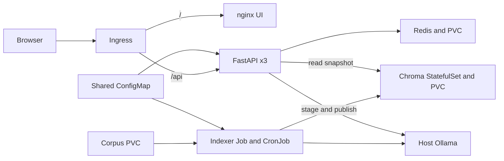
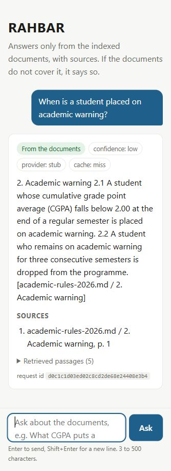

# RAHBAR

[](https://github.com/usmancodesprojects/rahbar-grounded-rag/actions/workflows/ci.yml)

RAHBAR answers student questions from public FAST-NUCES documents. It cites the policy and page behind each displayed excerpt, keeps superseded material available for explicitly dated questions, and declines when the retrieved evidence is insufficient.



## Apply order from a clean clone

Use Python 3.12, Bash, GNU Make, Docker, kubectl, minikube, and Ollama. Windows users can run the shell commands in WSL 2 with Docker Desktop integration.

```bash
git clone https://github.com/usmancodesprojects/rahbar-grounded-rag.git
cd rahbar-grounded-rag
make install
make test lint
make fetch
.venv/bin/python corpus/fetch.py --verify
git diff --exit-code -- corpus/MANIFEST.md
make cluster
make images
```

Start Ollama in a separate terminal with `OLLAMA_HOST=0.0.0.0 ollama serve`. Restrict the listening port to a trusted local network. Pull the pinned models before indexing.

```bash
ollama pull nomic-embed-text:v1.5
ollama pull llama3.2:3b
make apply
kubectl -n rahbar rollout status statefulset/chroma --timeout=240s
bash scripts/load_corpus.sh
kubectl -n rahbar patch job indexer --type=merge -p '{"spec":{"suspend":false}}'
kubectl -n rahbar wait --for=condition=complete job/indexer --timeout=3600s
kubectl -n rahbar rollout status deployment/api --timeout=240s
kubectl -n rahbar rollout status deployment/ui --timeout=240s
```

The initial Job is suspended until the corpus PVC is loaded. `make index` creates an on-demand Job from the same weekly CronJob template. Load a verified corpus before starting a Job when the files change. The API follows the published index without a rollout. Check the Ollama address with `minikube ssh -- grep host.minikube.internal /etc/hosts`. If it differs from `192.168.49.1`, update the API and indexer egress rules for port 11434 before applying.

On Windows or macOS, run `minikube tunnel` separately and pass `INGRESS_IP=127.0.0.1`. Map `rahbar.local` to the Ingress address in your hosts file to open the chat in a browser.

```bash
make ask Q="What CGPA does an undergraduate need to stay off academic warning?"
make ask Q="What is the hostel overnight visitor curfew at the Islamabad campus?"
make eval
```

Hosted generation is opt-in. Set `LLM_PROVIDER=hosted`, `HOSTED_BASE_URL`, and `LLM_MODEL`, allow HTTPS egress to the chosen endpoint, and create the Secret with `kubectl -n rahbar create secret generic rahbar-secret --from-literal=LLM_API_KEY="$LLM_API_KEY"`. Restart the API after changing its config.

## API endpoints

| Method and endpoint | Behavior |
| --- | --- |
| `POST /api/ask` | Accepts `{"question":"..."}` with 3–500 characters. Returns citations, retrieval references, abstention, and cache status. |
| `GET /healthz` | Process-only liveness. |
| `GET /readyz` | Checks a non-empty index, embedding pin, and Redis. Reports failures with 503. |
| `GET /metrics` | Prometheus counters and histograms. |

Use `kubectl -n rahbar port-forward service/api 8000:8000` to inspect internal health and metrics. An optional `X-Session-ID` enables expiring follow-up context. The response always echoes or generates `X-Request-ID`.

The screenshot below shows the Ingress-hosted chat using the CI fixture corpus.



The source documents are fetched through `corpus/fetch.py` and fingerprinted in [the corpus manifest](corpus/MANIFEST.md). See [architecture](docs/ARCHITECTURE.md), [pipeline](docs/PIPELINE.md), [failure experiments](docs/FAILURE-ANALYSIS.md), and [deployment evidence](docs/evidence/README.md).
